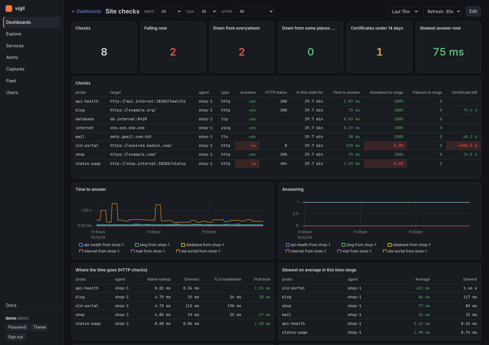
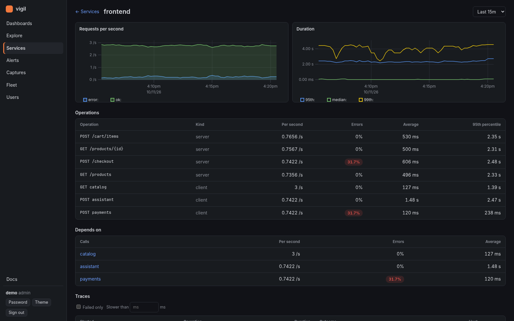
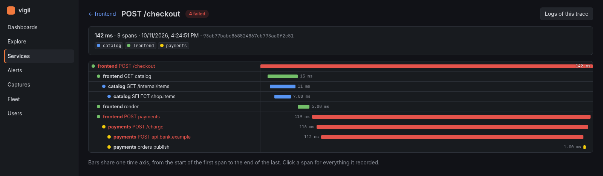
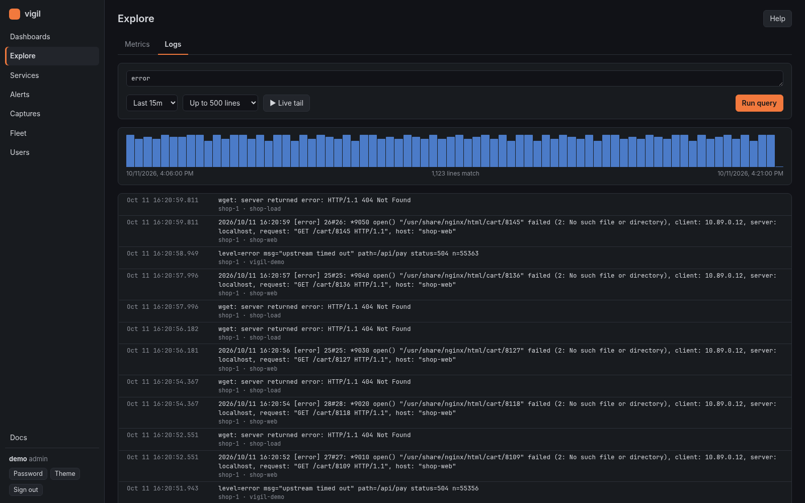
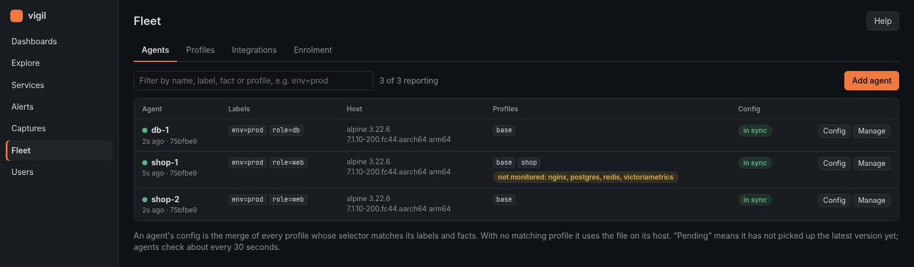
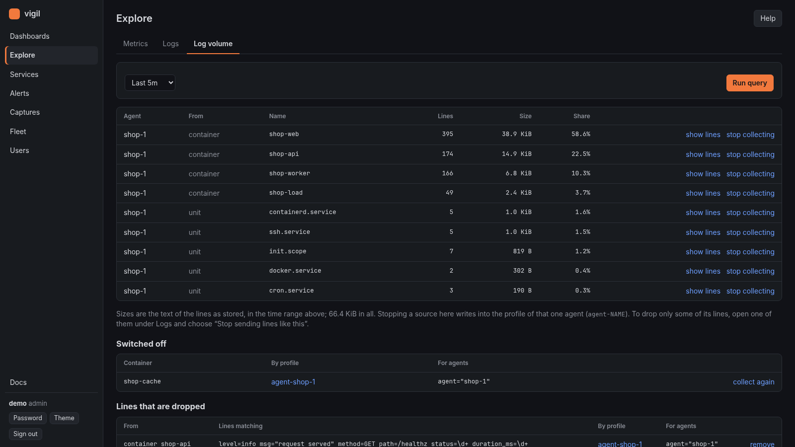
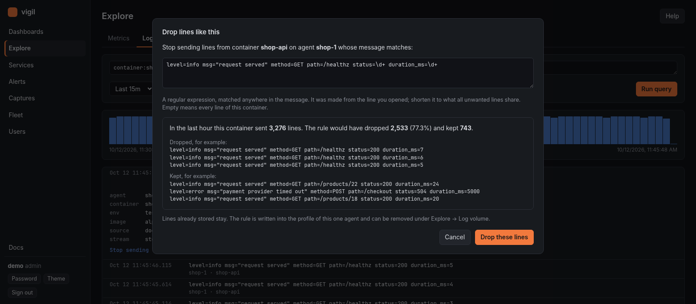
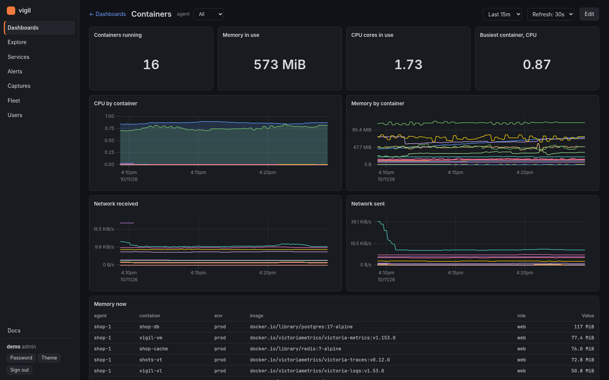

# vigil

Monitoring for servers and clusters in a few static Go binaries: metrics,
logs, alerts, site checks, traces and runtime security events, the
dashboards to look at them, and a Home page that says what needs attention.

It is for people who would otherwise wire an agent, a log shipper,
Alertmanager, a dashboard tool and a runtime-security tool together. The
agent runs on every host or Kubernetes node (`vigil-agent`), the central
server is `vigil-server`, and each is a static binary of its own.
VictoriaMetrics and VictoriaLogs store the data; VictoriaTraces, if you
add it, keeps traces.

Its own interface is optional. If you prefer Grafana, or already run one,
it connects to the vigil server with a read-only token: vigil then
collects, stores, manages the agents and alerts, and Grafana draws.
[How to connect it](docs/grafana.md).

A new server is useful before you configure anything: it alerts when a host
goes silent, a container stops, a site stops answering or a certificate is
about to expire, and it comes with dashboards for hosts, containers, site
checks, logs and AI costs.

**Status: early.** It runs on its author's servers and a home lab, not on
large fleets. Expect rough edges, and please say what you find.

| | |
|---|---|
|  **Services** from OpenTelemetry traces |  **Traces**, span by span |
|  **Logs** from files, journald and containers |  **Fleet**: agents configured from the server |
|  **Log volume**: who writes the logs, and a switch for each |  **Drop rules**, previewed before they are saved |
|  **Containers**: CPU, memory and network of each | |

## What it does

### Home: what needs attention

- **Incidents**: every firing alert, from a rule or a security detection,
  is one incident with a history: open, acknowledged with a note ("I'm on
  it"), resolved, reopened. Everything on a host that is down is listed
  under the host, a HAProxy server under its backend.
- **Since you last looked**: what opened and resolved since you last
  marked the page as seen, and whether the picture is complete (agents
  reporting, rules that cannot run, silences in effect).
- **Coming up**: disks that will be full within 30 days (as a range, only
  when the data is clean enough to say), certificates running out, agents
  held back by their limits.
- **AI spend** of the last day against a usual one, and alerts that keep
  coming back.
- **AI explanations, if you want them**: an admin previews exactly what
  would be sent about an incident, then asks a language model why it
  happened. vigil picks and masks the evidence, every claim in the answer
  cites it, a monthly budget is required, and nothing is sent until you set
  it up. [Home](docs/home.md)

### Collecting

- **Metrics**: host and container figures, Prometheus scraping (static
  lists, Kubernetes pods by annotation, tokens kept in a file on the host),
  process groups, systemd units, GPUs, OpenTelemetry (OTLP).
- **Logs**: files, journald, Docker containers, Kubernetes pods and events,
  with parsing templates. A log volume page shows who writes the most, and
  lines not worth keeping are dropped by a rule you preview first.
- **Site checks**: HTTP, TCP, TLS and ping from any agent, with the time
  left on certificates and where the time of a request goes.
- **Traces**: OpenTelemetry traces with request rate, errors and duration
  per service, a page per service, and a view of each trace.
- **Runtime events**: eBPF probes, security rules evaluated on the host, and
  captures of what happened around a detection.
- **Secrets stay home**: the agent masks keys, tokens and passwords in logs
  and spans before anything leaves the host.

### Alerting

- Prometheus-format rules on metrics and on logs, with the essential ones
  built in (host down, container down, check failing, certificate
  expiring) and more with each integration.
- Alertmanager inside for routing, contacts and silences, and a message to
  the contacts when someone silences an alert.

### AI and what it costs

- **Claude Code**: its own telemetry shows cost and tokens by person, model
  and subagent; a **Sessions** page shows each session's prompts and cost;
  `vigil-agent claude-hook` keeps an audit trail of what it ran and what was
  refused. [Claude Code](docs/claude-code.md)
- **Applications that call language models**: their OpenTelemetry spans are
  counted by model and priced with the prices you give.
- **GPUs**: utilisation, memory, temperature, and what idle GPU time costs.
- **One cost metric for all of it**, with what is billed kept apart from
  subscription use at API prices. [AI costs](docs/finops.md)

### Many hosts

- **Fleet**: what agents collect is managed on the server, in profiles
  selected by labels, which can be kept in git (`vigil apply`).
  Integrations bundle what one technology needs, and the server shows what
  runs unmonitored.
- **Staged rollouts** of a profile change, pausing by themselves when an
  agent cannot apply it.
- **Enrolment and encryption**: the server can be its own certificate
  authority, agents trust it by fingerprint and enrol with a short-lived
  token.
- **Relays** for sites that cannot reach the server, and **limits** on what
  one agent may send, kept by the agent and by the server.

### Looking at it

- **Web interface**: Home, Dashboards, Explore (with saved queries),
  Services, Sessions, Alerts, Captures, Fleet, Users; admin and viewer
  accounts.
- **Context and Explain on a log line** in Explore: how often lines like
  it come, the lines around it, what happened on the host then, and, with
  a language model set up, what it means. [Explore](docs/explore.md#a-lines-context)
- **Grafana, if you want it**: the server answers Grafana's data sources
  for metrics, logs, traces and alerts, through read-only tokens.
- **An API** for everything the interface does.

## Documentation

The guides are in [`docs/`](docs/README.md), and the server shows the same
pages under `/docs/` (the **Docs** link in the interface).

| | |
|---|---|
| [Install](docs/install.md) | server, agents, tokens, encryption, limits |
| [Install with an AI assistant](docs/install-by-ai.md) | a guide written for an assistant to follow |
| [Agent configuration](docs/configs.md) | every source, with recipes; masking secrets |
| [Fleet](docs/fleet.md) | labels, profiles, integrations, rollouts, `vigil apply` |
| [Kubernetes](docs/kubernetes.md) | node agents and the cluster agent |
| [Relays](docs/relay.md) | for agents that cannot reach the server |
| [Home](docs/home.md) | incidents, forecasts, AI explanations |
| [Explore](docs/explore.md) | PromQL and LogsQL with examples, saved queries |
| [Dashboards](docs/dashboards.md) | panels, variables, editing |
| [Services and traces](docs/apm.md) | OpenTelemetry as the APM |
| [GPUs and AI machines](docs/gpu.md) | NVIDIA and AMD GPUs: use, memory, health |
| [AI costs](docs/finops.md) | tokens, GPU hours, one cost metric |
| [Claude Code](docs/claude-code.md) | cost, sessions, audit trail |
| [Alerts](docs/alerts.md) | rules, incidents, contacts, silences |
| [Runtime events](docs/security.md) | events, rules, captures |
| [Grafana](docs/grafana.md) | read-only tokens, data sources, what stays in vigil |
| [Metric reference](docs/metrics.md) | what every metric means |
| [API](docs/api.md) | endpoints |
| [Troubleshooting](docs/troubleshooting.md) | when something does not work |

## Build

    make build     # bin/vigil-agent, vigil-server, vigil-relay and vigil for this machine
    make linux     # static bin/<name>-linux-{amd64,arm64}
    make size      # the agent's and relay's size budgets
    make test
    make bpf       # only after changing internal/events/bpf/events.c (needs podman or docker)

Building needs only Go: the compiled kernel probes and the interface's two
small JavaScript libraries are committed.

## Quick start

    # central node: server + VictoriaMetrics + VictoriaLogs
    printf 'VIGIL_INGEST_TOKEN=%s\nVIGIL_ADMIN_TOKEN=%s\n' "$(openssl rand -hex 24)" "$(openssl rand -hex 24)" > deploy/.env
    docker compose -f deploy/docker-compose.yml up -d

Open `http://localhost:8080`, sign in as `admin` with the admin token, and
use **Fleet → Add agent** to get the file for a first host. The rest is in
[Install](docs/install.md).

## For contributors

`memory/context/` records what is built, why it is built that way, where the
project is going and how to test it against real stores, a real kernel and a
real cluster. Read it before changing things. A change that adds or changes
what users can do also updates this README and the page in `docs/` that
says how to use it.

## License

GNU Affero General Public License v3.0; see [LICENSE](LICENSE). The kernel
probes in `internal/events/bpf/events.c` are dual BSD/GPL so the kernel
accepts them.
